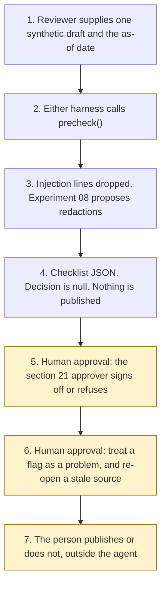

# Architecture

Experiment 23. Catalogue UK08. Autonomy A0.

The reviewer supplies one synthetic promotion and an as-of date. Either Copilot Studio harness calls `precheck()`. The Python core drops injection lines, asks Experiment 08 to propose redactions, and builds a checklist from the pinned extracts. Experiment 03 is called only when an inventory record and a requested lifecycle status are present, and the status is not applied. Experiment 04's marketing-page pin is recorded and is not overwritten. The checklist comes back with `s21_approver_decision` null.

The section 21 approver signs off, or refuses to. That step is not a tool. A stale source stays flagged until that person re-opens the page. A phrase match is not a compliance opinion. Nothing is published.

The rendered picture is [architecture_diagram.png](architecture_diagram.png), produced by [generate_diagram.py](generate_diagram.py). Matplotlib is used only for that script. It is not a runtime dependency.

What is not a tool, even after the approver has decided: recording the sign-off, publishing, drafting a replacement, giving a compliance opinion, looking up the register, writing a production record, and sending.
