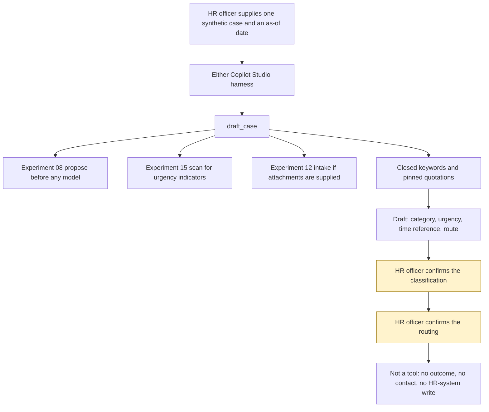

# Architecture

The runnable core is `src/draft.py`. `draft_case()` reads one JSON case and returns one JSON draft. The same case and the same as-of date produce the same JSON. `classification.decided` is false. `hr_confirmation.classification_confirmed` and `routing_confirmed` are false. `outcome` and `merits_advice` are null. `actions_taken` is empty.

## What each box does

| Step | Where it lives |
|---|---|
| Case | JSON the officer supplies. `synthetic` must be true in this starter. |
| Harness | [copilot-studio/README.md](../copilot-studio/README.md) or [github-copilot-harness.md](github-copilot-harness.md). Both call `draft_case()`. |
| Redaction | Experiment 08 `propose()`, caller `exp-32-employee-case-intake`. The redacted text is not stored. |
| Urgency | Experiment 15 `scan()`. Indicator categories are kept. Phrases and redacted text are not. |
| Attachments | Experiment 12 `intake()` with `requested_purpose` `general_records`. File bodies are not copied. |
| Classification | Closed keywords in `src/case_categories.py`, after instruction sentences are blanked. |
| Time reference | Quotations in `src/case_sources.py`, pinned 4 November 2026. No day count is encoded. |
| Human approval | The HR officer, outside the agent. `record_hr_confirmation` is not a tool of the agent. |

## What is not in the diagram as a system call

No HR system, mailbox, occupational-health system, Acas conciliation service, tribunal, or model. `network_called` and `model_called` are false.

## Diagram file

The rendered picture is [architecture_diagram.png](architecture_diagram.png), produced by [generate_diagram.py](generate_diagram.py). The Mermaid figure above is the same flow, with the two approval points highlighted.
