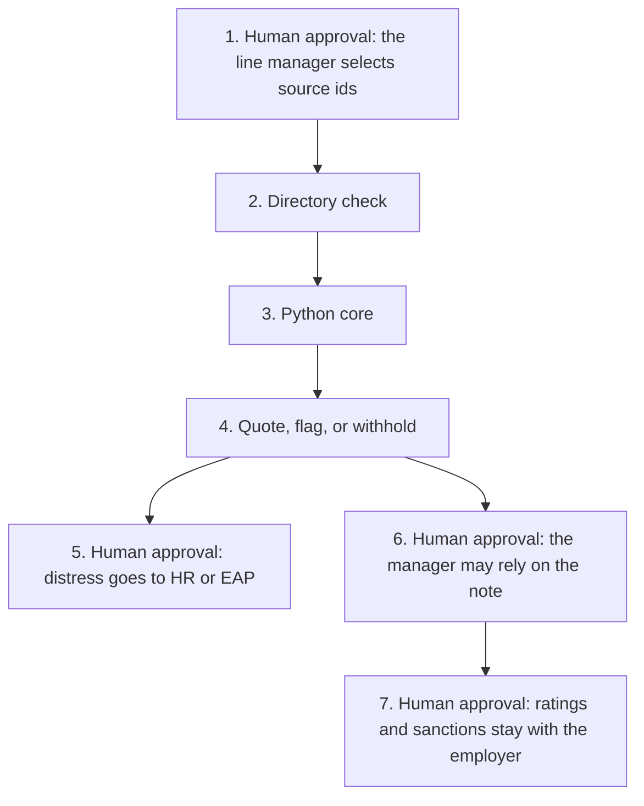

# Architecture

A line manager supplies one synthetic pack and an as-of date. The selection object is separate from the notes. `prepare()` checks the directory, quotes only the selected allowed sources, and does not rate anyone.

1. The manager selects source ids, on an object that is not the note text.
2. The directory, not the note, says who the line manager is and what clearance they hold.
3. Either harness calls `prepare()`. Experiment 15 flags phrases. Experiment 41 checks each quotation. Experiment 51 marks an action or a decision on a line. Experiment 08 proposes identifier redactions. None of their raw values are stored.
4. A follow-up is quoted with its source id and line. A denial is not an inclusion. A SECRET cover is withheld. A mailbox is not read.
5. A distress, wellbeing, safeguarding, or personal-circumstance line is a flag. The sentence is not copied.
6. Relying on the note is a seen-step for that meeting and those source ids. `acknowledge()` is not a tool of the agent.
7. Performance, comparison, discipline, and capability stay outside the agent.

The rendered diagram is [architecture_diagram.png](architecture_diagram.png).

| Piece | Role |
|---|---|
| `src/prepare.py` | The note. No network. |
| `src/marking.py` | Higher marking, legal hold, retention. |
| `src/concerns.py` | Paraphrase and negation. |
| `src/reuse.py` | Experiments 08, 15, 41, and 51, in process. |
| Copilot Studio | Topics or skills that call the same function and stop. |
| Microsoft Foundry | Optional narrative of fields that are already in the JSON. Not used by the tests. |
