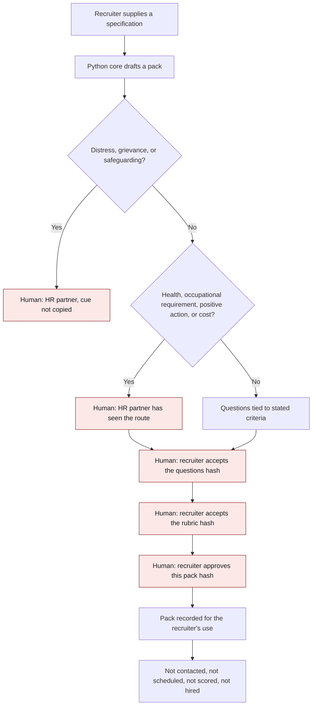

# Architecture

Experiment 65, catalogue H008, autonomy A1. One Python core, two Copilot Studio harnesses, and an optional Microsoft Foundry note. The recruiter approves the questions and the scoring rubric. The agent does not contact candidates, schedule interviews, score or rank anyone, or make a hiring decision.

The highlighted steps are the only approval steps. Text inside the job description is not one of them.

The rendered picture is [architecture_diagram.png](architecture_diagram.png). Regenerate it with `python docs/generate_diagram.py` from this experiment folder. Matplotlib is used only for that script.

## What crosses the boundary

| From | To | What moves |
| --- | --- | --- |
| Recruiter | Either harness | One synthetic request, the guide, the directory, and the question date |
| Either harness | `src/pack.py` | The same objects. Approval keys on the request are not read as approval |
| `src/pack.py` | Experiment 08 | The text, for identifier counts. Values are not stored |
| `src/pack.py` | Experiment 64 | The text, for the example wording list |
| Core | Recruiter | The JSON. `human_approval` is null |
| Recruiter | `record_questions_approval` and `record_rubric_approval` | A decision object with the hashes |
| HR partner | `record_hr_seen` | A seen object with the route hash |
| Recruiter | `record_pack_approval` | The pack hash, after the earlier steps |

There is no tool whose effect is to email a candidate, write a calendar entry, score a person, or decide who is hired.
