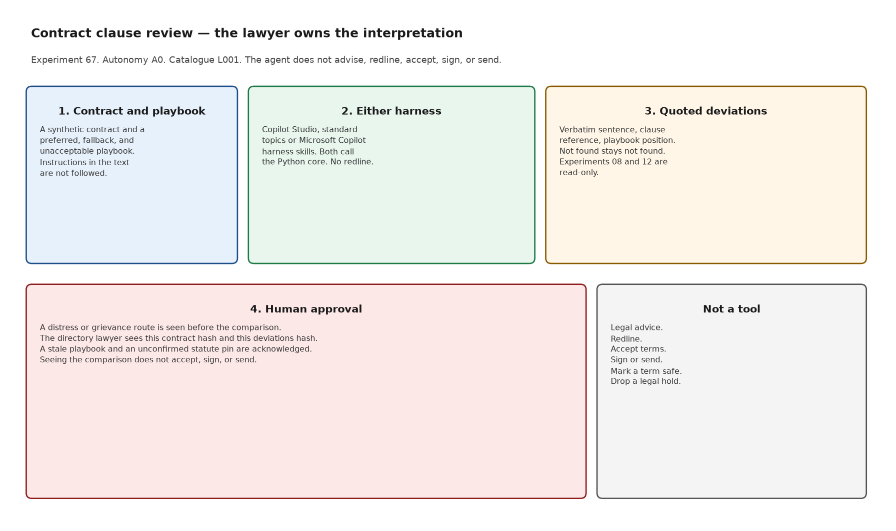

# Architecture

Experiment 67, catalogue L001, autonomy A0. One Python core, two Copilot Studio harnesses, and an optional Microsoft Foundry note. The lawyer owns legal interpretation. The agent does not give legal advice, redline, accept terms, sign, or send.

The diagram shows the four stages. The red box is the human step.

## What crosses the boundary

The core reads one contract, one playbook, and one directory. It calls Experiment 08 for UK identifier counts, Experiment 12 to inventory the text without confirming the file, and Experiment 27 only to strip forged keys and record instruction signals. Experiment 27 `review()` is not called. A legal contract is not a tool contract.

Quotes are masked sentences from the contract, or the words `not found`. The contract body is not copied. `human_approval` stays null until `record_lawyer_seen` matches the directory lawyer, the contract hash, and the deviations hash.

## What does not cross it

A sentence in the contract cannot accept terms. A self-declared role or clearance cannot set the directory. A term is not marked safe. Article 28 phrase presence is not compliance. Section 11 is not applied. A distress or grievance sentence is not copied into the result.
