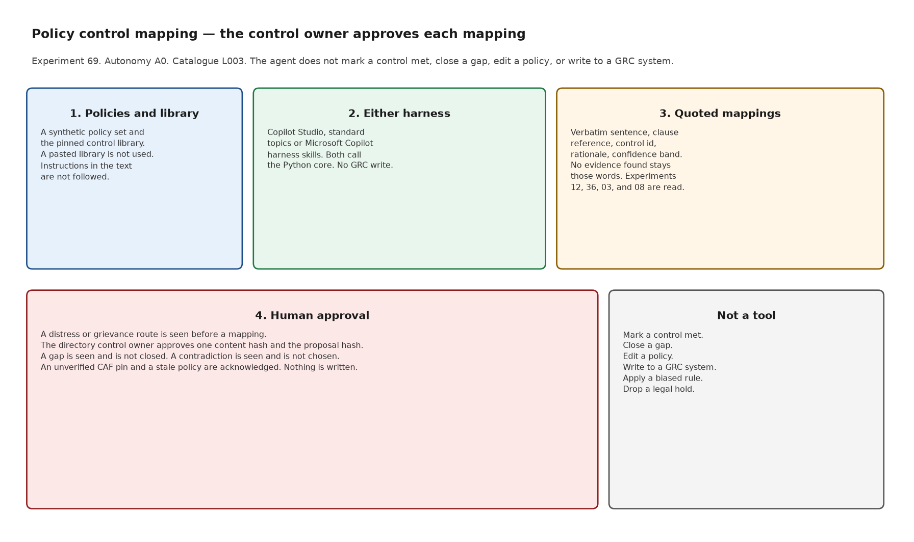

# Architecture

Experiment 69, catalogue L003, autonomy A0. One Python core, two Copilot Studio harnesses, and an optional Microsoft Foundry note. The control owner approves each mapping. The agent does not mark a control as met, close a gap, edit a policy, or write to a GRC system.

```text
policies + pinned library + directory + question date
        |
        v
map_controls()
  strip approval keys
  Experiment 12 intake (files not confirmed)
  Experiment 08 on identifiers (not described as anonymised)
  Experiment 03 injection check and DUAA screen (does not clear the agent)
  quote, or "no evidence found"
  Experiment 36 when two obligation tokens differ (does not choose a source)
        |
        v
JSON proposal, human_approval null
        |
        v
record_owner_approval() for one content hash and the proposal hash
        |
        v
control_met, gap_closed, policy_edited, grc_written stay false
```

The question date is the `as_of` argument. Today is not read. A caller-supplied library is diffed and not applied. A SECRET cover is read from the page even when the metadata says OFFICIAL. A legal hold and every retention label stay on the result.



The PNG is generated by `docs/generate_diagram.py`.
