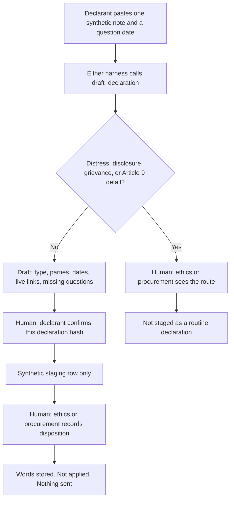

# Architecture

The declarant supplies one synthetic declaration and the date the question is about. Either Copilot Studio harness calls the same Python core. The core reads the pinned supplier list, procurement register, and directory. It does not trust copies of those files inside the request.

Experiment 08 counts UK identifiers and does not return a reversible vault into this result. Experiment 12 inventories the text and does not confirm the file or a purpose. Experiment 32's keyword and injection helpers are read. `draft_case()` is not called.

The draft lists interest type, parties as supplier ids, dates, financial or non-financial, missing questions, and potential links to procurements that are live on the question date. `conflict_exists` stays null.

**Human approval.** The directory member of staff confirms that declaration hash. Only then is a row written to the synthetic staging store. An ethics or procurement officer records disposition against that staged hash. The words are not interpreted. A distress, disclosure, grievance, or special-category route is seen by that officer and is not staged as a routine declaration.

Clearing, excluding, approving, and sending are not tools.

The rendered picture is [architecture_diagram.png](architecture_diagram.png). It shows the same four stages and the actions that are not tools.
