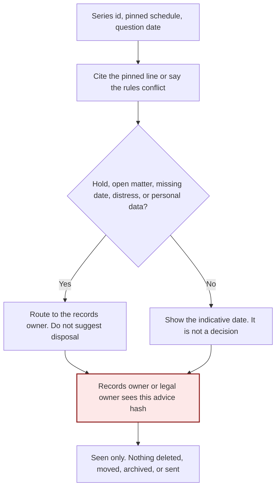

# Architecture

Experiment 71, catalogue ID L007. Autonomy A0. The records owner decides.

The runnable core is `src/advice.py`. Both Copilot Studio harnesses call it. Neither harness deletes, moves, relabels, archives, or sends.

1. The records owner supplies one synthetic series id, their directory reference, and the date the question is about. A pasted schedule is not the pinned schedule.
2. The core matches active pinned lines, parses the trigger, and either calculates an indicative date or says why it cannot. Instructions in the title or the note are recorded and not followed.
3. A legal hold, an open FOI, SAR, litigation, or inquiry, conflicting lines, a missing or unreadable date, personal data, a public record selected for permanent preservation, or a distress cue is routed to the records owner. Disposal is not suggested.
4. **Human approval:** the directory records owner for that series, or a legal owner, records that they have seen this advice hash. Boolean acknowledgements cover unverified pins, a stale schedule, and a caller source that differs. A string is not enough. The step does not authorise disposal, transfer, or a hold change.
5. Deleting, moving, relabelling, archiving, transferring, disposing, and sending are not tools.

Experiment 01 supplies a keyword class and an urgency level. Experiment 08 counts UK identifiers. Experiment 12 inventories the note without confirming the file. Those results are not copied into the advice as text, and they are not a determination.

