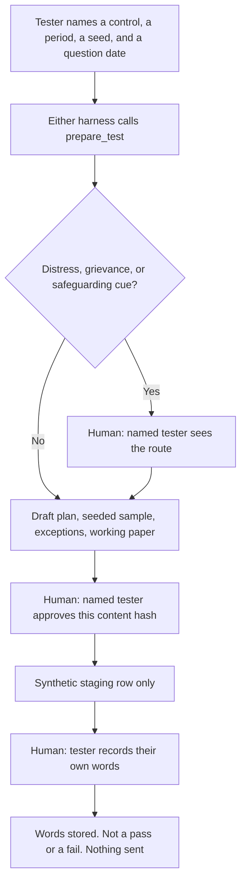

# Architecture

The tester names one control, a period, a sample seed, and the date the question is about. Either Copilot Studio harness calls the same Python core. The core reads the pinned control library, the pinned evidence population, and the pinned directory. It does not trust copies of those files inside the request.

Experiment 08 counts UK identifiers and does not return a reversible vault into this result. Experiment 12 inventories up to 12 evidence files and does not confirm the file or a purpose. Experiment 69 maps a policy clause when the control has one. That mapping is not a test result, and it does not pass the control.

The draft lists the objective, the seeded sample, the size rationale, and every exception with its evidence id. `control_passed` stays null.

**Human approval.** A distress, grievance, or safeguarding route is seen by the named tester and is not staged as a routine test. The directory tester named on the draft approves that content hash. Only then is a row written to the synthetic staging store. The same tester may record their own words against that hash. The words are not interpreted. Passing, failing, closing, and sending are not tools.

The rendered picture is [architecture_diagram.png](architecture_diagram.png). It shows the same stages and the actions that are not tools.
