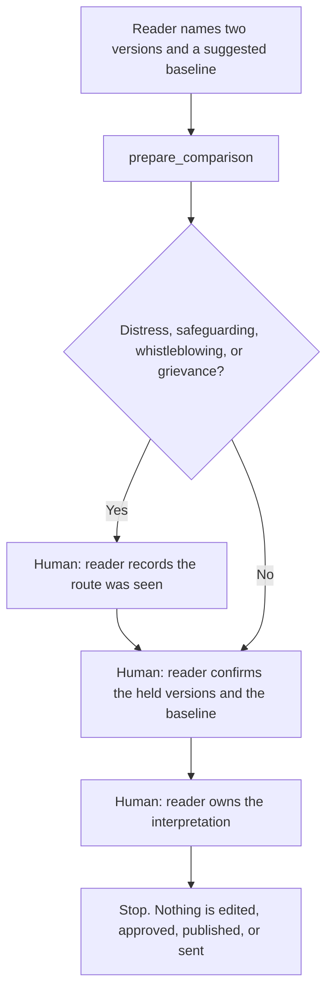

# Architecture

The reader names two synthetic versions and which one is the suggested baseline. Either Copilot Studio harness calls `prepare_comparison()`. The Python core aligns the clauses, cites both versions, and lists the checks. It keeps an in-memory copy of that comparison and of each document body.

If the text has a distress, safeguarding, whistleblowing, or grievance cue, the outcome is `route_to_human`. The named reader records that they have seen the route. They then confirm the held versions. They then record that they own the interpretation. None of those steps edits, approves, publishes, or sends the document.

Experiment 12 inventories the two texts and does not confirm the files. Experiment 08 counts UK identifiers and does not store the matched values. Experiment 33 supplies `normalise` and `resolve_span`. Experiment 29 supplies `extract_numbers` and `extract_dates`. Experiment 38 `compare()` is not called.

A Microsoft Foundry note is optional and is not called by the sample. The diagram is `docs/architecture_diagram.png`, drawn by `docs/generate_diagram.py`. The site copies that file at build time.

