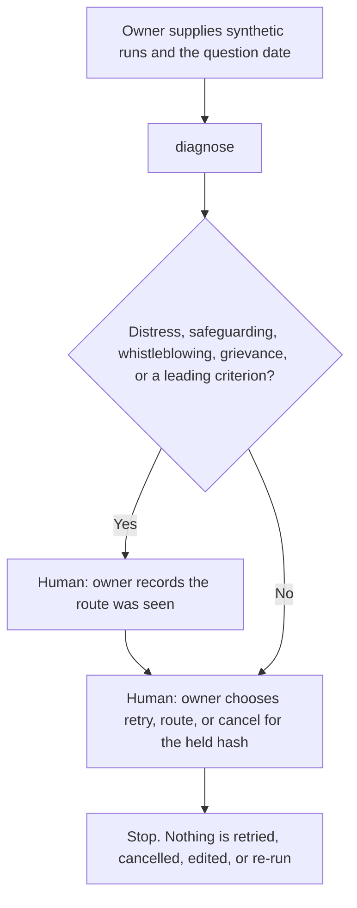

# Architecture

The process owner supplies synthetic run histories and the date the question is about. Either Copilot Studio harness calls `diagnose()`. The Python core classifies each failure from the pinned taxonomy, groups related runs, and keeps an in-memory copy of that proposal and its hash.

If the text has a distress, safeguarding, whistleblowing, or grievance cue, or a leading criterion, the outcome is `route_to_human`. The named owner records that they have seen the route. They then choose retry, route, or cancel for that hash. Neither step retries, cancels, edits a record, or re-runs a flow.

Experiment 08 counts UK identifiers and does not store the matched values. Experiment 17 is not called.

A Microsoft Foundry note is optional and is not called by the sample. The diagram is `docs/architecture_diagram.png`, drawn by `docs/generate_diagram.py`. The site copies that file at build time.

