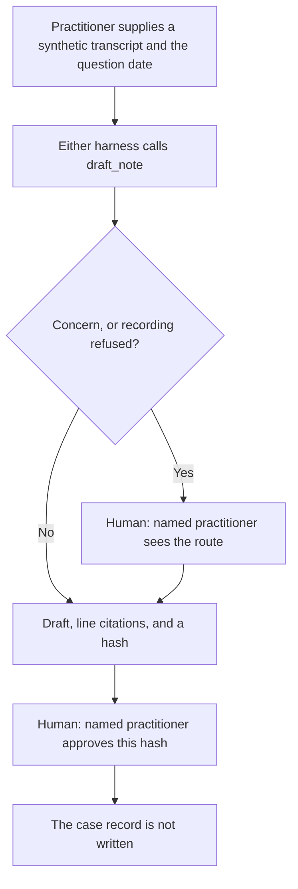

# Architecture

The runnable core is `src/notes.py`. Both Copilot Studio harnesses call that core. Neither harness writes a case record.

1. The practitioner supplies a synthetic transcript, the service, their directory reference, and the date the question is about.
2. `draft_note` reads the pinned template and the pinned directory. A template or directory in the request is compared and not applied.
3. Each clear line is copied into one section and cited. Unclear audio, crosstalk, and a misattributed line are flagged and not assigned.
4. Experiment 08 counts UK identifiers. Phones, emails, dates of birth, addresses, names, and NHS numbers are masked. The report says the masked text is in the note. It does not say the note is anonymised.
5. Experiment 12 inventories rough notes. Those sentences stay the practitioner's. They are not the person's own words.
6. Concern language is flagged. The flag does not copy the words and does not assess risk, need, or eligibility.
7. The draft and its hash are held in memory. `human_approval` is null.
8. If a route is required, the named practitioner records that they have seen it. That updates the held hash.
9. The named practitioner approves that hash, or returns it for edit. A later edit of the approved note is refused. The case record is not written.

The case-record write, the share, and the assessment are not tools. They are drawn on the architecture diagram as outside the path.
